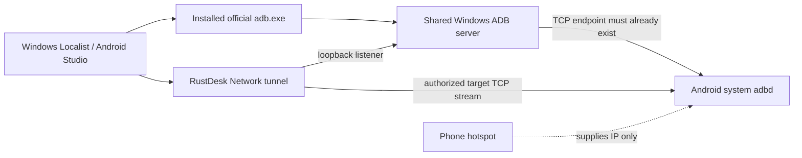

# Localist Developer Bridge — Architecture

## Decisions

**ADR-DB-001 — Use installed official ADB.** Windows Localist runs the selected Android SDK `adb.exe` with structured arguments and no shell. Android Studio can share the local ADB server when configured with the same Platform-Tools.

**ADR-DB-002 — Treat network and device debugging as separate layers.** A hotspot or RustDesk tunnel supplies IP connectivity only. Android's system `adbd` must already be listening and authorized before ADB or Android Studio can see the device. Localist does not silently enable it or bypass the Android sandbox.

**ADR-DB-003 — Reuse RustDesk for Internet transport.** The Internet tab opens the existing desktop `port-forward` session. The user maps a Windows loopback port to an already active Android ADB endpoint and approves the exact incoming tunnel on the phone. This transport is not presented as working without that endpoint.

## Components

The page is Windows-only and uses the existing Localist layout. No Android permission, native ADB service, custom protocol, cloud identity, root path, or settings automation is added.

## Hotspot flow

1. The feature starts disabled. The user enables it; Localist finds the installed ADB client and reads the device list.
2. The PC joins the phone hotspot.
3. The user enters the exact active ADB endpoint and selects Connect. Android's system must already expose and authorize that ADB TCP endpoint.
4. The feature shows ADB's actual result. It does not infer that the hotspot IP is also an ADB endpoint.

With the phone never connected by USB and Wireless debugging off, stock Android does not provide the required ADB TCP endpoint. Android 11+ official wireless deployment requires Wireless debugging enabled and the workstation/device on the same Wi-Fi network. The legacy `adb tcpip` method requires an initial USB connection.

## Internet flow through RustDesk

1. The Android Localist host is online and the user enters its RustDesk ID/password in the Internet tab.
2. Windows Localist opens the existing Network tunnel / `port-forward` session.
3. The user maps an unused Windows local port to the exact active endpoint on Android and approves the target-specific incoming tunnel on the phone.
4. Windows ADB connects to the mapped `127.0.0.1` endpoint.
5. Closing the RustDesk session revokes the route.

RustDesk does not start `adbd`, alter Developer Options, or mint Android ADB authorization. Thus the tunnel cannot solve the absent-endpoint case. The full path is **NOT TESTED**.

## Process and state handling

ADB commands use argument arrays, `runInShell: false`, timeouts, and captured output. The screen does not run USB-mode switches, pairing, or settings changes. The ADB service keeps device state, endpoint, executable path/version, diagnostics, and busy state in memory. It has no background reconnect loop and does not kill the shared ADB server used by Android Studio.

